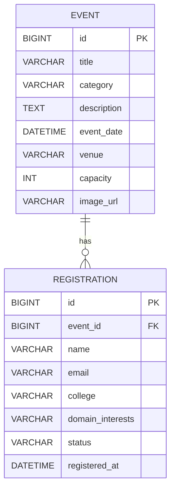
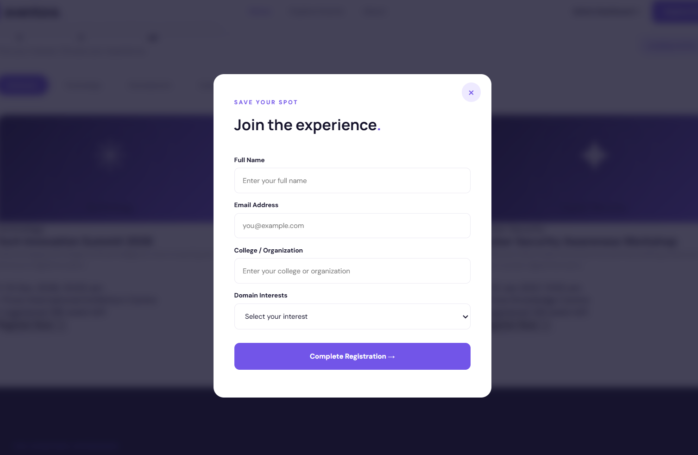
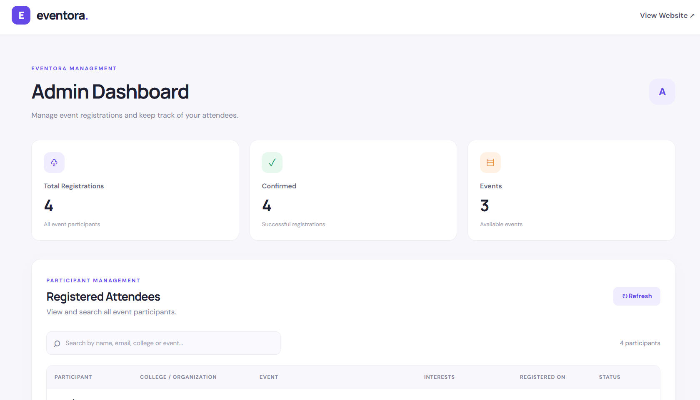

# Eventora – Event Registration Platform

## 1. Project Overview

Eventora is a web-based Event Registration Platform developed using Java, Spring Boot, MySQL, HTML, CSS and JavaScript.

It allows participants to explore upcoming events, view event details and register online. Administrators can view registered participants, search attendee records and monitor registration statistics.

## 2. Features

- Display upcoming events with descriptions, dates and venues.
- Filter events by category.
- Online participant registration.
- Validate registration form fields.
- Prevent duplicate registration using email and event ID.
- Display available seats and registered participant counts dynamically.
- Admin dashboard to view all registrations.
- Search attendees by name, email or college.
- Display registration status badges.
- Prevent registrations when event capacity is full.

## 3. Technologies Used

| Technology | Purpose |
|---|---|
| Java 21 | Backend programming |
| Spring Boot | Backend framework |
| Spring Data JPA | Database operations |
| MySQL | Database |
| HTML5 | Page structure |
| CSS3 | Styling and responsive design |
| JavaScript | Frontend functionality |
| Maven | Project management |

## 4. Project Structure

```text
event-registration-platform/
│
├── src/
│   └── main/
│       ├── java/com/codenova/eventregistration/
│       │   ├── config/
│       │   ├── controller/
│       │   ├── dto/
│       │   ├── entity/
│       │   ├── exception/
│       │   ├── repository/
│       │   └── service/
│       │
│       └── resources/
│           ├── static/
│           │   ├── index.html
│           │   ├── admin.html
│           │   ├── style.css
│           │   ├── admin.css
│           │   ├── app.js
│           │   └── admin.js
│           │
│           └── application.properties
│
├── pom.xml
└── README.md
```

## 5. Database Configuration

Database name: `event_registration_db`

Create the database in MySQL:

```sql
CREATE DATABASE event_registration_db;
```

Configure the database connection in `application.properties`:

```properties
spring.datasource.url=jdbc:mysql://localhost:3306/event_registration_db
spring.datasource.username=root
spring.datasource.password=YOUR_MYSQL_PASSWORD

spring.datasource.driver-class-name=com.mysql.cj.jdbc.Driver
spring.jpa.hibernate.ddl-auto=update
spring.jpa.open-in-view=false
```

Replace `YOUR_MYSQL_PASSWORD` with your local MySQL password.

## 6. Database Schema

Eventora uses two main entities: Event and Registration.



Each event can have multiple registrations. Each registration belongs to one event.

A unique constraint on `event_id` and `email` prevents the same email address from registering for the same event more than once.

## 7. Sample Seed Data

The application automatically inserts sample events when the database is empty.

| Event Name | Category | Capacity |
|---|---|---:|
| Tech Innovation Summit 2026 | Technology | 200 |
| Web Development Bootcamp | Development | 100 |
| Cyber Security Awareness Workshop | Cyber Security | 150 |

## 8. API Endpoints

| Method | Endpoint | Description |
|---|---|---|
| GET | `/api/events` | Get all events |
| GET | `/api/events/{id}` | Get event by ID |
| POST | `/api/events/{id}/registrations` | Register participant |
| GET | `/api/admin/registrations` | Get all registrations |
| GET | `/api/admin/registrations?search=value` | Search registrations |

Duplicate registration returns HTTP status `409 Conflict`.

## 9. How to Run the Project

1. Install Java 21 and MySQL.
2. Create the `event_registration_db` database.
3. Configure the MySQL username and password in `application.properties`.
4. Open the project in VS Code.
5. Open the terminal in the project folder.
6. Run:

```powershell
.\mvnw.cmd spring-boot:run
```

7. Open the application in your browser:

**Eventora Homepage:**  
`http://localhost:8080/index.html`

**Admin Dashboard:**  
`http://localhost:8080/admin.html`

## 10. Screenshots

### Participant Registration



### Admin Dashboard



## 11. Conclusion

Eventora provides a simple and user-friendly platform for event discovery and online registration. It helps participants register easily and enables administrators to manage attendees efficiently. The project demonstrates the integration of frontend technologies, Java Spring Boot and MySQL database management.